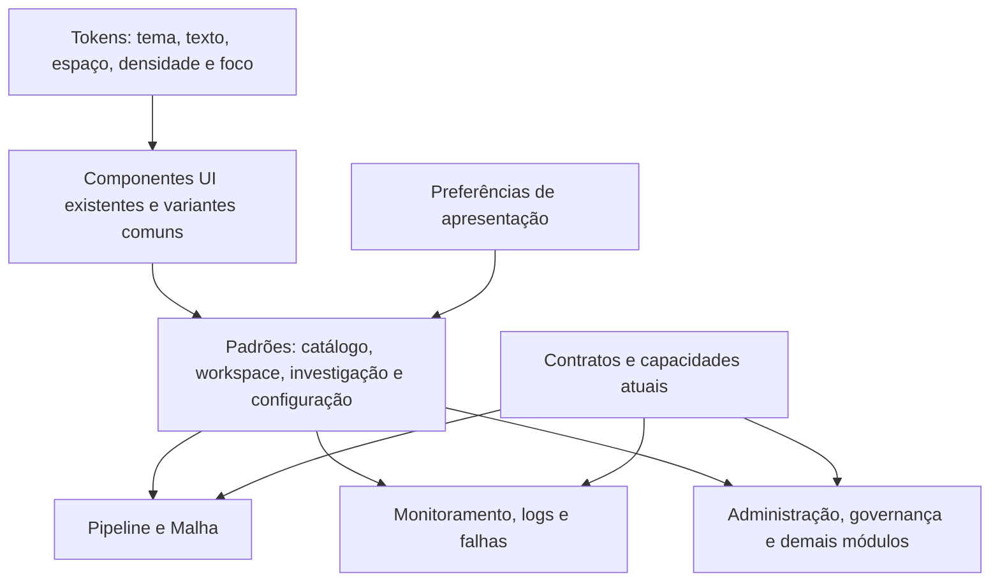

# Arquitetura visual e adoção em toda a ferramenta

## Arquitetura sugerida

Construir consistência em quatro níveis: tokens semânticos → componentes base → padrões de página → jornadas por módulo. Manter dados, contratos, autorização e motor nas camadas existentes; preferências visuais não governam execução.

Referências de código: `src/index.css`, `tailwind.config.js`, `components/ui`, `components/layout/Sidebar.tsx`, `components/layout/header/HeaderV2.tsx`, `WorkspaceEditor`, `WorkspaceCanvas`, `WorkspaceOperations`, `WorkspaceRunInspector`, `WorkspacePipelineFields`, `SharedJobConfiguration` e `SpecializedConfiguration`. Os padrões são propostas; não afirmar que uma camada de presets/design system completa já existe.

## Navegação proposta para revisão

Agrupar destinos pela intenção: projetar, operar, governar e administrar. Esses grupos são linguagem candidata; preservar rotas, acessos e aliases. Pipeline mantém os cinco destinos definidos na SPEC. Malha tem seu contexto próprio. Execução pode ser acessada pelo objeto ou pela visão operacional, sempre com retorno/identidade.

Antes de reorganizar menus, inventariar todos os destinos atuais, frequência por público e RBAC. O usuário autorizou propor unificação visual, mas essa proposta ainda não aprova uma ordem final dos objetos nem troca silenciosa de rotas. A migração deve manter links e tarefas conhecidas.

## Famílias de página

| Família | Estrutura visual | Aplicação candidata |
|---|---|---|
| Catálogo | Título/ação, busca/filtros, tabela, resumo/paginação | Pipelines, inventário, jobs, conexões e modelos |
| Workspace | Identidade/modo, abas, ferramentas, área principal e inspector | Pipeline e Malha |
| Investigação | Corrida/intervalo/fonte, estado, mapa/lista/timeline e diagnóstico | Execução, logs, gestão de falhas |
| Configuração | Seções semânticas, formulário real, valor efetivo/origem, ações | Pipeline, etapa, administração |
| Visão analítica | Indicadores orientados a decisão, filtros e comparação | Dashboard, performance e indicadores de chamados |
| Trabalho operacional | Fila/tabela, prioridade, responsável, detalhe e histórico | Chamados, avisos, planos de ajuste e atividades |

Essas famílias vêm do inventário de páginas na fonte; não são auditoria funcional completa de todos os módulos. PowerBI, agentes/IA, utilitários e serviços externos precisam de revisão específica. Login/identidade conserva seus ativos e fluxo de segurança; conteúdo operacional deve compartilhar a tipografia e os controles quando aplicável.

## O que muda globalmente versus por módulo

| Global | Específico do contexto |
|---|---|
| Fonte/escala, cores semânticas, foco, ícones e espaçamento | Grafo de etapas versus grafo de pipelines |
| Cabeçalhos, menus, abas, tabela/form e estados | Correlação por data de negócio e dependências inter-pipelines |
| Densidade, tratamento de texto longo e overlays | Histórico e ações da corrida/tentativa exata |
| Preferência de apresentação e reset coerentes | Políticas de cada tipo e capacidade do motor |
| Vocabulário comum de ação e feedback | Campos especializados de DataStage/SQL/Python/etc. |

Não criar um tema exclusivo de Pipeline e outro de Malha. Usar o mesmo vocabulário de superfície, texto, estado e interação, com estruturas adequadas ao trabalho.

## Sequência de adoção proposta

| Onda candidata | Entrega | Condição para avançar |
|---|---|---|
| V0 — inventário | Screenshots reais autorizados, mapa de componentes/rotas e inconsistências | Evidência nos dois temas, estados e públicos; sem registrar dados sensíveis |
| V1 — base | Tokens/escala/foco e catálogo de componentes visuais | Paridade visual e semântica dos controles; sem perda de contraste/legibilidade |
| V2 — shell | Cabeçalho, navegação, contexto e estrutura de página | Jornadas/links/RBAC preservados e menu compreensível |
| V3 — piloto | Catálogo Pipeline, Montagem e investigação da corrida | Aceites Pipeline existentes e critérios visuais, com usuários |
| V4 — Malha | Composição, leitura e diagnóstico contextual | Contratos da Malha reconfirmados; novos requisitos especificados |
| V5 — expansão | Admin, governança, inventário, falhas, chamados e demais famílias | Cobertura de cada módulo e substituição progressiva de exceções |

V0–V5 são ondas de design locais, não novas fases F1–F9, migrations ou versões reservadas. Cada implementação segue o processo de SPEC/PR/QA/DEV do repositório. Não executar deploy por se tratar de alteração “só visual”.

## Aceites visuais verificáveis

- Tema claro e escuro cobrem todas as superfícies, menus, controles, overlays e estados.
- A mesma ação/componente tem a mesma hierarquia nas famílias de página.
- Nenhum campo/tipo/agenda/guard/RBAC desaparece com simplificação visual.
- Em1440/1280/947px, conteúdo e ferramentas são utilizáveis; em390px oferecer lista/detalhe e seleção, sem prometer montagem útil apenas porque não existe overflow.
- Zoom200% mantém leitura/ações; nome longo não cobre status, botões ou portas do grafo.
- Teclado permite navegar, selecionar, configurar, investigar e retornar sem drag obrigatório.
- Densidade/layout/reset preservam payload, posse, agenda, corrida e filtros contratados.
- Vazio, erro, carregamento, read-only, dirty, stale e sucesso têm tratamentos coerentes.
- Tabelas de grande volume e grafos grandes são avaliados com fixtures; não prometer desempenho por screenshot.
- Um autor encontra/retoma draft; um operador identifica a corrida e causa conhecida; um responsável encontra impacto/prazo. Registrar ajuda, erro e tempo, sem inventar benchmark.

## Entrega solicitada ao próximo agente

Além da análise funcional, produzir auditoria visual global, especificação dos tokens/componentes, arquitetura de informação, mapa de tipos de objeto, telas por família nos dois temas, política de densidade/responsividade e plano de adoção. Classificar o que pode ser refinado sobre componentes existentes versus o que exige novo contrato. Mostrar comparação antes/proposta com conteúdo real sanitizado e decisões explicadas. Não implementar a substituição da ferramenta sem aprovação da especificação e plano.
