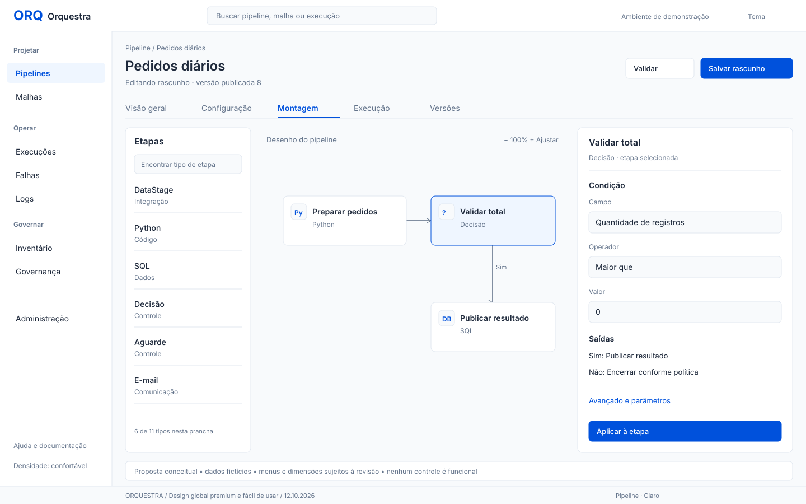
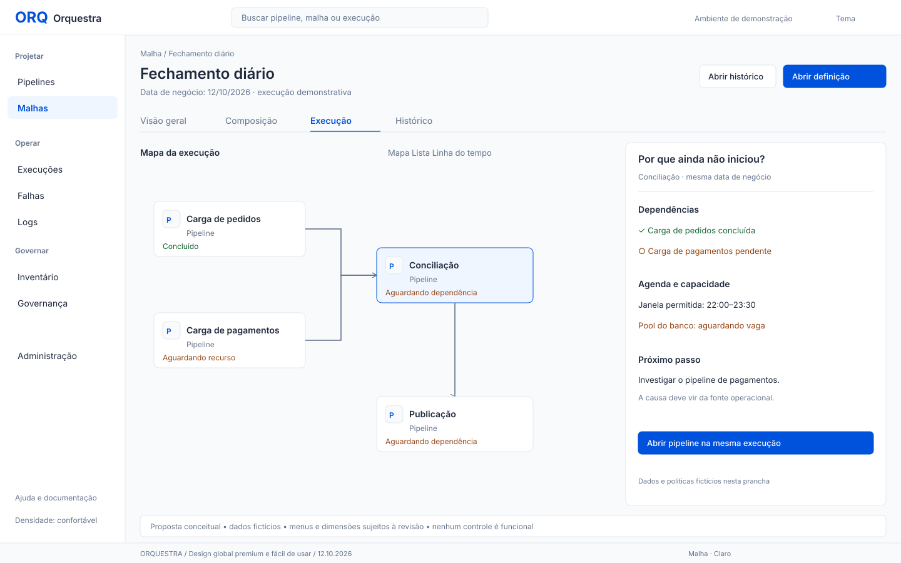
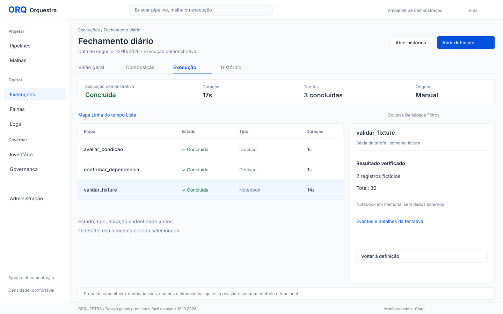
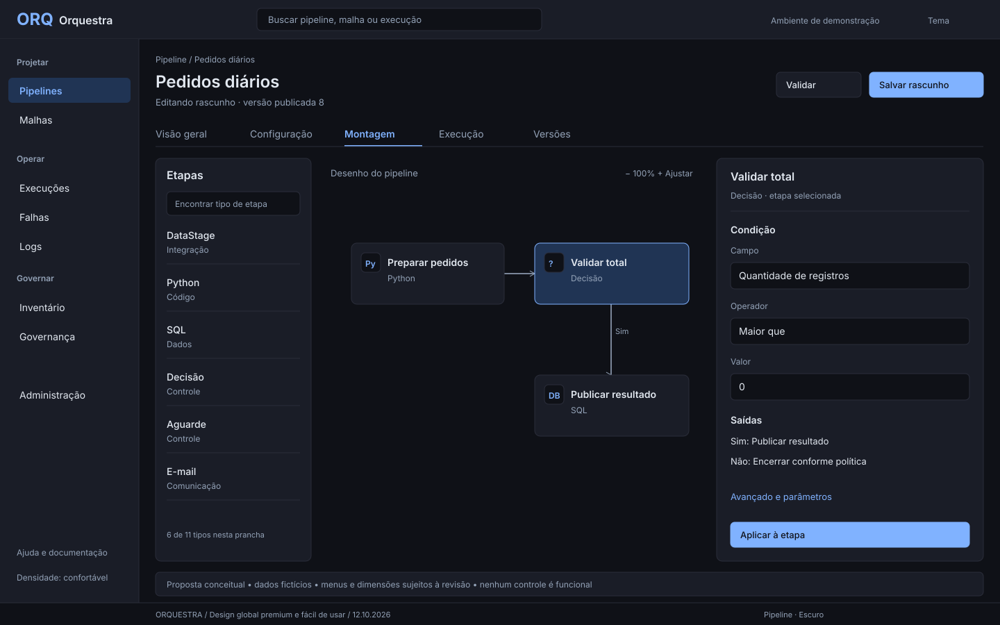

# Pranchas conceituais para revisão

Desenhos vetoriais com dados fictícios. Comunicam hierarquia e direção, não implementam telas. A tipografia depende da fonte instalada no visualizador; a proposta final usa fontes locais verificadas. As categorias/menus mostrados são candidatos, não inventário completo de destinos.

Pipeline: biblioteca recolhível, contexto e abas, ação primária e propriedade selecionada. A prancha mostra seis tipos como amostra; os onze tipos e formulários reais devem ser preservados. Mudanças de desenho não alteram payload ou saídas.

Malha: pipelines como objetos compostos, causa de espera por data/condição/recurso e entrada no pipeline da mesma instância. Os dados de pool/janela são fictícios e não afirmam capacidade atual do motor.

Monitoramento: identidade/resultado, três tarefas, duração e saída da fixture. “Decisão”/“Notebook” são termos da demonstração e não proposta de criar tipo Notebook no Orquestra. O padrão é mostrar o tipo real conforme o produto.

Tema escuro: mesmas posições, proporções e papéis de cor; não é uma segunda identidade. O desenho contém caminhos simplificados de exemplo; não certifica editor/canvas funcional.

Para avaliar: distinguir objeto/contexto/estado/ação; testar fonte, nomes longos, foco, contraste, teclado, zoom e larguras reais. As pranchas não aprovam automaticamente menu novo, densidade, políticas ou features.
