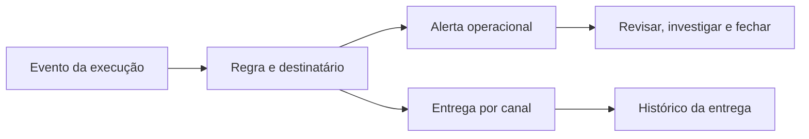

# Notificações, alertas e tratamento operacional

Data: 13/10/2026. Escopo: Informatica CDI, Databricks Lakeflow Jobs, Control-M e implicações para o Orquestra. Pesquisa oficial complementar aos ensaios anteriores. Nenhum destinatário configurado ou mensagem enviada nesta rodada. Control-M continua sem tenant operacional: regras descritas são documentais e os tours mostram exemplos, não entrega real.

## Modelo para entender as ferramentas

Há quatro objetos distintos: evento da execução, política que decide comunicar, tentativa de entrega pelo canal e alerta/incidente que uma pessoa trata. Sucesso/falha/aviso são resultados ou categorias; Normal/Urgent/Critical é prioridade; lido/revisado/fechado é tratamento. Esses eixos não devem ser fundidos em um campo.

Este diagrama é síntese conceitual para o Orquestra, não implementação interna dos fornecedores. Marcar como lido não prova resolução; o job concluir não prova que o e-mail chegou; falha de transporte não deve substituir o estado do processamento.

## Informatica Data Integration

Na administração da organização, a documentação define destinatários padrão separados para falha, warning e sucesso. Configurações específicas da tarefa/taskflow substituem os endereços organizacionais, conforme essa regra documentada. Fonte: [Organization Administration, novembro2024](https://docs.informatica.com/content/dam/source/GUID-5/GUID-56CEAA43-125F-4EAB-9375-F7529800021D/41/en/IICS_November2024_OrganizationAdministration_en.pdf). Não foi alterada administração no tenant observado.

No taskflow, Notification Task é um passo explícito de e-mail, com destinatários e conteúdo; pode usar dados do fluxo. O manual consultado descreve To/Cc/Bcc e restrição a distribution lists nesses campos. É necessário reconfirmar essa restrição na versão do tenant antes de projetar distribuição corporativa. Fonte: [Taskflows, novembro2024](https://docs.informatica.com/content/dam/source/GUID-8/GUID-89D0C881-8DA9-4C78-A348-61C72A98256F/56/en/CDI_November2024_Taskflows_en.pdf).

Na observação anterior, Mapping Task tinha Email Notification; Data Task exibia políticas On Error/On Warning. São responsabilidades distintas: tratamento da execução versus comunicação. Monitor preserva acompanhamento da instância. Não se testou envio, recuperação de entrega ou uma fila de incidentes equivalente ao Alerts do Control-M.

Exemplo conceitual: uma falha técnica segue a política de erro da Data Task; um caminho de exceção pode compor uma mensagem de negócio. O desenho precisa evitar envio duplicado pela tarefa e pelo taskflow e verificar o estado final efetivo. Essa é recomendação de configuração, não política automática demonstrada.

## Databricks Lakeflow Jobs

Notificações podem ser configuradas no job e nas tasks: início, sucesso, falha, duração acima de limite e backlog de streaming. A configuração fica em Job notifications → Edit notifications; destinos externos são preparados por administrador. E-mail, Slack, Teams, PagerDuty e webhook estão documentados.

Job-level não avisa cada falha de task enquanto ela é repetida; task-level permite esse recorte e opção de silenciar até a última tentativa. Silenciamento de skipped/canceled no job não cobre automaticamente notificações próprias das tasks. Succeeded with failures conta como sucesso para essa configuração. Aviso de duração exige um limite; no streaming, a avaliação usa média de10min e repetição com intervalo de30min. São regras específicas, não um cooldown global de todos os eventos.

Fonte: [Notifications](https://docs.databricks.com/aws/en/jobs/notifications). No workspace Free, os grupos de configuração foram vistos e a fixture executou; destinos/entregas não foram configurados. Runs permite investigação; a pesquisa não comprova fila nativa New/Reviewed/Closed ou escalonamento por ausência de reconhecimento. Para integrar incidentes, definir contrato com a ferramenta de plantão/ITSM.

DB-013, observação de13/10: aberto Job notifications → Add notification do ORQ_UX_DEMO. O formulário mostrou Email/Teams/PagerDuty/Slack/Webhook, colunas Start/Success/Failure/Duration warning/Streaming backlog/Maintenance start/Maintenance complete e mute para skipped/canceled. A linha provisória veio com Failure marcado; destino ficou vazio e Save desabilitado. Cancel descartou o formulário e o resumo confirmou No notifications. Não foi alterado o default global nem criado destino. Os eventos de manutenção não comprovam disponibilidade para este job não contínuo. O inventário confirmou sessão Informatica, Databricks e tour BMC, sem console operacional Control-M.

## Control-M: configuração, roteamento e operação

### Regras na definição

Em Planning, selecionar job e abrir Actions. Configurar notificações depois da conclusão para Ended OK/Ended Not OK; antes da conclusão para início atrasado, execução prolongada, término atrasado e eventos cíclicos. Definir mensagem, destino e urgência Normal/Urgent/Critical. A seção “before completion” também abrange condições durante a execução.

If-Actions permite reagir a estado, código de retorno, número de falhas/reruns, saída ou variável. Notify comunica; Rerun Job repete; Stop Cyclic Run impede novas iterações. São ações distintas. Set to OK altera o status mesmo após Not OK: não significa recuperação técnica comprovada.

Fontes: [Actions](https://documents.bmc.com/supportu/controlm-saas/en-US/Documentation/Job_actions.htm), [Automation API Job Properties](https://documents.bmc.com/supportu/API/Monthly/en-US/Documentation/API_CodeRef_JobProperties.htm). A API oferece propriedades de notificação como DoesNotStart, ExecutionTime e DoesNotEnd; schemas/enumerações devem seguir a versão contratada, não ser derivados de rótulos da UI.

### Destinatários centralizados

Notification Destinations fica em Configuration → Control-M/Servers → Notification Destinations. Uma regra usa um nome lógico; a lista ativa resolve o destino real. É possível manter listas por turno com o mesmo nome lógico e destinatários diferentes, ativando uma por vez. A troca de turno depende da ativação/configuração; não assumir rotação automática só pela existência das listas.

Destinos documentados incluem Mail, Log, Control-M/EM (Alerts) e Program para OS jobs. Configuração exige a permissão administrativa indicada pela BMC. Não assumir que Teams/Slack são opções diretas universais da lista: canais adicionais dependem da integração adequada à edição. Fonte: [Notification Destinations](https://documents.bmc.com/supportu/controlm-saas/en-US/Documentation/Notification_Destinations.htm).

### Tratamento em Alerts

Alerts recebe mensagens direcionadas ao console, término Ended Not OK automático e informações de SLA. Há urgência, comentário, acesso ao job e estados New, Reviewed e Closed. O operador pode filtrar por período, servidor, host e aplicação, e configurar toast. Reviewed registra revisão; Closed representa encerramento do problema. Nada disso comprova reparo do job por si só.

Control-M SaaS documenta envio de alertas a sistemas externos por stream/listener, separado de Mail. Fonte: [Alerts](https://documents.bmc.com/supportu/controlm-saas/en-US/Documentation/Alerts.htm). Verificar edição, permissões e integração antes de usar endpoints. Não confundir esse mecanismo com um webhook genérico disponível em qualquer versão.

### Prazo e impacto da malha

Service Management permite acompanhar serviços/SLA, progresso e previsão de término, investigando problemas que ameaçam conclusão no prazo. Isso acrescenta a perspectiva do processo de negócio à falha individual. Fonte: [Service Management](https://documents.bmc.com/supportu/controlm-saas/en-US/Documentation/Service_Management.htm). Forecast/Self-Healing vistos nos tours não certificam SLA real no ambiente.

## Exemplo de política a projetar no Control-M

Exemplo fictício de fechamento financeiro; horários, limites e destinatários são escolhas a validar, não defaults do produto.

| Situação desejada | Desenho da política | Destinatário/efeito esperado |
|---|---|---|
| Conclusão normal do fechamento | Comunicar uma vez no encerramento do escopo de negócio | Responsável, mensagem informativa |
| Job termina com erro | Registrar exceção e apontar corrida/job | Operação, investigar antes de repetir |
| Não iniciou até22:05 | Aviso preventivo | Plantão, identificar agenda/dependência/recurso |
| Continua executando por20min | Aviso de demora | Operação, avaliar impacto no prazo |
| Terceira falha de serviço transitório | Encerrar repetição e escalar conforme desenho aprovado | Nível técnico responsável |
| Processo concluído após intervenção | Mensagem de recuperação correlacionada ao incidente | Mesmos responsáveis; não esconder falhas anteriores |

Implementar em definição de teste, verificar resolução dos destinos, publicar/check-in conforme fluxo e observar execução/alerta/entrega separadamente. Testar a contagem de falhas/reruns da edição e o escopo da instância. Escalonamento após várias falhas foi mostrado no tour; escalonamento por “não reconhecido em X minutos” precisa de regra/integração própria e não foi confirmado como automático.

Uma falha pode já gerar alerta automático; Notify adicional para Alerts pode causar comunicação redundante. Antes de padronizar, medir quais eventos chegam e definir política de duplicidade. Enviar sucesso a cada job tende a dispersar atenção: recomendar sucesso do processo e falhas acionáveis como política de produto, sem alterar o processamento.

## Orquestra atual e evolução proposta

Inspeção de fonte no commit92d14d5: `api/services/notify.py` registra notificações por matrícula em `dbo.etl_notificacao`, com info/success/warning/error, título, mensagem e link. É best-effort: falha de registro vira warning no log sem propagar ao chamador. `api/routers/notificacoes.py` lista por usuário, conta não lidas e marca como lidas. Isso comprova central individual de leitura; não certifica gestão de incidentes ou entrega multicanal confiável. Outros emissores/canais existentes exigem auditoria própria; esta leitura não afirma que eles não existem.

Para a estrutura premium, separar:

1. **Políticas:** quais eventos, escopo global/malha/pipeline/etapa, valor herdado/efetivo, última tentativa ou cada tentativa e responsáveis.
2. **Destinos:** catálogo de grupos/canais e plantão, credenciais protegidas e permissões de alteração.
3. **Entregas:** registro persistente, tentativas de envio, confirmação disponível, falha de transporte e reenvio controlado. O envio falhar não reclassifica o job.
4. **Alertas:** prioridade, estado de tratamento, responsável, comentários e vínculo à corrida/tentativa/data de negócio.
5. **Interface global:** estado operacional no canvas, central de alertas para ação e inbox pessoal para informação; toast apenas como sinal temporário.

São propostas, não capacidades já entregues. Reutilizar tipos/templates/canais reais e reconciliar com backlog antes de criar tabelas ou novos controles.

## Matriz mínima de validação

| Caso | Prova exigida |
|---|---|
| Sucesso | Evento correto, uma comunicação esperada e link à mesma corrida |
| Falha com retry | Política cada tentativa/última tentativa e histórico preservado |
| Aviso sem falha | Execução mantém seu estado real; prioridade é independente |
| Canal indisponível | Incidente continua visível; entrega falha e pode ser reenviada |
| Mudança de turno | Destino efetivo correto, sem editar cada definição |
| Operador lê/resolve | Lido, reconhecido e resolvido têm efeitos distintos |
| Recuperação | Evento correlacionado, motivo e corrida/tentativa corretos |
| Duplicidade | Mesmo evento não gera tempestade de mensagens; envios distintos são rastreáveis |
| Dados sensíveis | Mensagem contém contexto mínimo; logs/anexos respeitam autorização |

Não foi enviado e-mail, Teams, Slack ou PagerDuty nem criada integração externa nesta investigação. Teste de entrega requer destinatário de teste expressamente autorizado e ambiente adequado.
