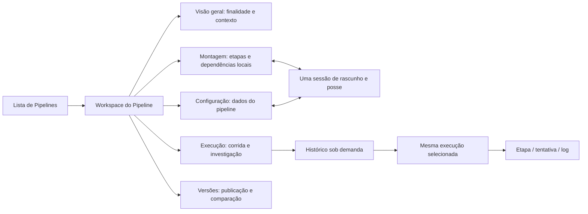

> Estado consolidado em 12/10/2026: Informatica em leitura; Databricks com duas tentativas reais, a segunda Succeeded em17s, três tarefas e notebook fictício; Control-M com cinco tours guiados e nenhum motor real. Relatos de histórico vazio e acesso pendente são da rodada inicial. A expansão para Malha foi solicitada depois da SPEC Pipeline. Leia o guia do agente para distinguir evidência e proposta.

# Proposta de experiência para o Orquestra

Estado: proposta revisável após Informatica e autoria demonstrativa Databricks; operação Databricks e Control-M guiado observado; motor real pendentes. A estrutura premium/customizável não está fechada. Data: 12/10/2026.

## Decisão arquitetural

Evoluir a experiência sobre os componentes e contratos atuais. Não trocar React/.NET/FastAPI, não reescrever Airflow/DataStage e não transplantar a taxonomia ou as regras do fornecedor. O objetivo é reduzir esforço para encontrar, construir e investigar um pipeline preservando a autoridade do servidor.

Três caminhos foram considerados:

| Caminho | Benefício | Limite | Decisão |
|---|---|---|---|
| Copiar composição e funcionalidades da referência | Aparência familiar a usuários do fornecedor | Cria tipos/ações sem contrato e perde identidade/preservação | Não recomendado |
| Redesenhar apenas espaçamentos | Menor mudança visual | Não resolve descoberta do draft, identidade de corrida e paridade | Insuficiente sozinho |
| Reorganizar/refinar a base atual, fechar F2 e validar aceites | Reutiliza investimentos e permite rollout incremental | Exige evidência integrada, não apenas screenshot | Recomendado |

Esse caminho já é compatível com a SPEC. A auditoria mostra que boa parte dele está no develop; o trabalho seguinte começa por lacunas e aceites, não por criar outro workspace.

## Arquitetura de informação



As cinco abas são existentes (`workspaceTabs.ts`), não novidade. UI-003/005 do Informatica sustentam melhorar descoberta; UI-007/019/020 sustentam contexto e responsabilidades; UI-016/017 sustentam investigação de instância.

Projetos/domínios permanecem cadastros existentes. Uma árvore de pastas ou tags editáveis adicional só entra com contrato próprio. “Workspace” designa aqui o espaço contextual de um pipeline; não replica um ambiente Databricks inteiro. O glossário em 09 diferencia esses conceitos.

## Entrada e descoberta — a lacuna F2

Reutilizar `Pipelines`, `PipelineRow` e `PipelineCreate`, conectando o índice .NET previsto em SPEC §3. Uma linha por pipeline, conforme a collation real, com nome amigável, ID técnico, projeto/domínio, publicação, draft, edição válida e atualização. Flags podem coexistir: publicado com draft não vira duas linhas; draft não prova editor ativo.

Filtros: busca, projeto, domínio e estados `all/draft/published/editing/inactive`; paginação no servidor, debounce e cancelamento conforme o contrato já proposto. Valores desconhecidos ficam nulos/rotulados. O indicador de edição vem de lease válida no servidor e não da existência de um rascunho.

Ao criar um draft, retornar à lista deve permitir reencontrá-lo sem ativar cadastro/DAG. Ao abrir e voltar, conservar filtros/página quando a navegação e a sessão permitirem. Só mostrar ações que capabilities autorizam; a experiência escolhida não concede permissões.

A entrada legada Fluxo fica sob a política de piloto/compatibilidade vigente. Não acrescentar menu Etapas. Aliases de fluxo/etapas/ferramentas devem chegar a Montagem sem ampliar acesso; logs/execuções devem preservar contexto operacional; parâmetros devem chegar à Configuração correta.

## Composição de Montagem

```text
Breadcrumb / nome / ID técnico        Salvar rascunho | Validar | Publicar
Visão geral | Montagem | Execução | Configuração | Versões
Rascunho / revisão / posse / salvo ou alterações locais

Biblioteca      Canvas compartilhado, dominante         Inspector contextual
recolhível      zoom / localizar / organizar             campos da etapa
11 tipos       seleção / arestas / dependências          subseções / modo focado

               Validação recolhível: erro/aviso → etapa/campo
```

Referência UI-006/008: biblioteca e propriedades liberam espaço quando recolhidas. **Escolha de design do Orquestra:** manter inspector lateral do contrato, não migrar para o painel inferior do Informatica sem comparação de tarefas.

Metas do contrato, não medições desta rodada: biblioteca 192–224 px, inspector 320–360 px; restante para canvas em 1440/1280. Nó 176–208 px com nome legível em duas linhas. À medida que a largura cai, recolher biblioteca/inspector em vez de manter três colunas inúteis. A 947, drawers/painel adaptável; a 390, modo focado e detalhes alcançáveis. UI-011 evidencia por que ausência de overflow não basta.

Reutilizar WorkspaceEditor, WorkspaceCanvas, WorkspaceFlowNode, NodeProperties, SharedJobConfiguration e SpecializedConfiguration. O histórico local de até 50 patches já existe; manter exclusão de valores protegidos. Recolher painéis não descarta staging do formulário, dirty, seleção ou zoom.

### Operação e seleção

- Selecionar nó abre seu inspector; selecionar aresta torna a conexão identificável e removível apenas em Montagem autorizada.
- Delete não age em input/textarea/editor de texto; confirmação pelo Modal do design system, respeitando regra atual.
- Alternativa ao drag: inclusão por clique e localizador; Enter seleciona nó focado. Escape fecha a superfície pertinente e retorna foco ao gatilho.
- Organizar altera layout; ordem executável não se deduz de posição. Decisão preserva ramos/saídas e referências.
- Configurar/aplicar muda o draft local. Salvar confirma revisão. Publicar segue intenção e reconciliação. Nenhuma animação ou toast transforma solicitação em publicação confirmada.

O diagnóstico inferior deve levar ao campo correto e explicar erro/aviso; não criar outra superfície de edição. Se essa navegação já existir, completar seu aceite, sem duplicar lógica.

## Configuração do pipeline

Manter grupos Identificação, Agenda/dependências, Parâmetros, Políticas de execução, Notificações e Documentação. UI-020 mostra configuração extensa fora do canvas; a matriz do Orquestra define quais campos e significados preservar.

Reutilizar WorkspaceConfiguration/WorkspacePipelineFields/WorkspaceParameters/WorkspaceDraftTools. Compartilhar a mesma sessão do WorkspaceEditor com Montagem. Sem novo draft por aba, sem segunda lease, sem save independente que sobrescreva staging de outro grupo.

Governança, agenda, SLA, pool, retries, política sem movimento, parâmetros/importação e runbook não ocupam permanentemente o canvas. Resumos na Visão geral são leitura com atalho ao editor canônico. Identificador técnico permanece segundo o contrato; nome amigável não renomeia referências silenciosamente.

Indisponibilidade de catálogo conserva valor legado. Formulários mesclam apenas campos alterados e preservam desconhecidos/defaults/nulls. Fuso selecionável, timeout global, novo responsável editável ou campos similares entram como novo escopo quando não houver chave/contrato comprovados.

## Composição de Execução

```text
Nome / execução selecionada / data / versão      Executar | Mais autorizado
Visão geral | Montagem | Execução | Configuração | Versões
Histórico | estado | última atualização / fonte / frequência

Canvas compartilhado somente leitura           Inspector da etapa
ou tabela alternativa                          Resumo / Tentativas / Logs
                                               Parâmetros autorizados
```

UI-016/017 distingue lista de instâncias e subtarefas. O Orquestra já possui WorkspaceOperations, WorkspaceRunInspector, canvas comum, tabela alternativa e histórico sob demanda. Preservar isso. My Jobs vazio não equivale a Monitor sem histórico; monitores globais existentes podem encaminhar para o contexto do Pipeline sem criar uma investigação paralela.

Identidade obrigatória: pipeline + runId + versão/fonte da definição + taskId + tentativa. Snapshot desconhecido recebe aviso de que o desenho usa a configuração publicada disponível; nunca adotar o rascunho silenciosamente. Atualização não troca corrida, seleção, tentativa, zoom ou posição de nó.

Corrida sem telemetria não vira sucesso. Executando, em fila, aguardando dependência, pulada, falha, pausa marcada, parada efetiva e desconhecido são fatos diferentes. Caminho entre nós não prova tráfego nem sucesso. Estado visual usa rótulo/ícone e cor, com movimento reduzido e sem atividade animada em histórico encerrado.

Reprocessar/pausar seguem guardas existentes e confirmação contextual; não copiar Resume/Skip/Stop do Informatica. O backend conserva autoridade sobre corrida antiga, versão, cascata e alvo exato. A tentativa do motor não se confunde com solicitação operacional ou nova corrida. Logs são texto escapado, erro/vazio/indisponibilidade distintos e filtros cercados pela identidade.

Cadência atual de 30 s fica visível. Alvo 5 s da SPEC depende de benchmark e autorização, não é melhoria automática a ativar. Separar atraso de telemetria e atraso de UI; manter último estado com carimbo e aviso quando a fonte cair.

## Tipografia, feedback e design system

Aplicar tokens existentes claro/escuro e fontes locais; não copiar marca, cores ou código proprietário. Título/controle/status devem seguir contrato e contraste mensurável. Nomes longos continuam identificáveis; tooltip é complemento, não único acesso ao nome.

Modal/confirm/toast da aplicação nas interações internas. Mensagem de campo associada ao rótulo e resumo acessível. Erro de save conserva trabalho; publicação pendente conserva contexto; 401/403/409/422/503 não se confundem. Evitar anunciar cada polling; anunciar alterações relevantes da etapa selecionada e publicação.

UI-021 confirma apenas Escape/foco de um diálogo no fornecedor. O aceite do Orquestra exige teclado em canvas, inspector, erro, confirmação e retorno à lista, em ambos os temas; nenhuma certificação completa de acessibilidade foi inferida dessa evidência.

## Customização premium — hipóteses para a rodada comparativa

Pedido adicional do usuário: construir uma estrutura customizável com qualidade premium e terminologia de mercado. A proposta inicial separa **preferência visual**, **configuração de definição** e **política administrativa**:

| Camada | Candidatos | Guarda e estado |
|---|---|---|
| Preferências pessoais de apresentação | Largura/recolhimento de painéis, densidade, colunas, filtros, visão gráfico/tabela | Sem mudar payload do pipeline, versão ou permissão; persistência durável ainda precisa de contrato |
| Definição operacional | Etapas, parâmetros, agendas, políticas e dependências atuais | Draft/revisão/lease/publicação existentes; nenhuma preferência de tela muda semântica |
| Governança/ambiente | Capabilities, política de piloto, acesso a campos e ações | Autoridade de servidor; não fazer personalização conceder acesso |
| Extensibilidade futura | Templates, subfluxos, monitores/malha versionada, calendário/fuso avançado | Novo escopo, dependências e aprovação próprias |

“Premium” será medido por previsibilidade, preservação de trabalho/contexto, investigação explicável, acessibilidade e desempenho — não pela quantidade de widgets. Visões salvas ou docking persistente são hipóteses UX-10, não promessa de capacidade já existente.

Antes de fechar: observar Databricks/Control-M práticos, entrevistar três públicos, reconciliar backlog e validar fixtures. Não definir arquitetura de plugins, schema de preferências ou tecnologia de eventos apenas a partir de um screenshot.

## Malha: recorte separado

Mockup03 e requisitos de autoria/assinatura fundamentam preservar retorno e dependências inter-pipelines atuais. Não autorizam um workspace versionado de Malha, comparação premium de malhas ou monitores estratégicos nesta SPEC. Registrar candidatos em UX-10 e detalhar em documento próprio após a rodada Control-M; o workspace Pipeline não depende desses projetos para concluir F2/F6.

## Ordem de revisão e implementação

Reconfirmar DEV/patch operacional → F2 descoberta/entrada → aceites integrados da sessão e paridade → refinamentos comprovados do canvas/investigação → rodada prática comparativa → decisão premium → piloto/rollout. Testar invariantes antes de aparência; comparar capturas nas mesmas larguras/fixtures; registrar diferenças intencionais. Os critérios verificáveis e o mapa funcional estão em 05/06.


## Atualização após autorização de execução e estudo da Malha

O estado atual inclui DB-011/012: primeira tentativa real falhou com tarefas puladas; segunda, com notebook fictício adicional, concluiu Succeeded em17s e mostrou total30. Graph/Timeline/List foram inspecionados. As declarações anteriores de histórico vazio/ausência de execução descrevem a rodada inicial. Repair/retry, carga e RBAC premium continuam não ensaiados.

Control-M CTM-006–010 inclui cinco tours guiados: Build a workflow, Error handling, Reference folder, Forecast e Self-Healing. As pendências anteriores de liberação estão resolvidas. Sem console operacional, nenhum job real Control-M foi executado. A nova proposta de composição, configuração, operação, recursos e governança está em [12-malha-conceitos-e-reestruturacao.md](../malhas/conceitos-e-reestruturacao.md); amplia o estudo, sem reclassificar recursos novos como SPEC Pipeline existente.
