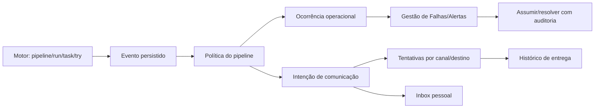

# Spec: experiência profissional e operação integrada — ORQUESTRA

Data: 2026-10-13 · Status: **aprovada pelo usuário em 13/10/2026; execução EOC-F0**.
Identificador: **EOC**. Base integrada: `develop` `92d14d596c95212d10bd30c3085edde4ce7c6b83`. Referência comparativa: branch `docs/analises-ux-modulos-malha`, commit `5a6dbf3644a2002ca967516163200e7924ea8659`. Referência documental Pipeline: `52c0c589` e seus registros posteriores no develop.

## 1. Visão

Consolidar a experiência de autores, operadores e responsáveis por processos: encontrar trabalho, montar e configurar fluxos, publicar, acompanhar a instância correta, comunicar resultados e tratar ocorrências. Preservar o investimento em Pipeline, Malha, formulários especializados e motores atuais; evoluir a interface e os contratos de forma incremental, com linguagem comum, área útil ampla e contexto inequívoco.

Esta SPEC integra as análises de Informatica, Databricks e Control-M, o design global proposto e as pendências reais das SPECs anteriores. Não transforma funcionalidades já implementadas em trabalho novo. Aprovação documental não certifica funcionamento externo nem entrega atual; execução aprovada pelo usuário em 13/10/2026: Claude desenvolve, Codex revisa/valida, integração e publicação em DEV por fase, resumo ao usuário e continuidade automática. Main/produção e envios externos mantêm gates próprios.

### Bases, fontes e confiança

- [Guia do estudo](https://github.com/carlosdev-joy/sge_app/blob/5a6dbf3644a2002ca967516163200e7924ea8659/docs/analises-ux-modulos/GUIA-DO-AGENTE.md): ordem, distinções de evidência e limites.
- [Índice completo](https://github.com/carlosdev-joy/sge_app/tree/5a6dbf3644a2002ca967516163200e7924ea8659/docs/analises-ux-modulos): módulos, glossário, jornadas, matrizes, backlog e preservação.
- [Design global](https://github.com/carlosdev-joy/sge_app/tree/5a6dbf3644a2002ca967516163200e7924ea8659/docs/analises-ux-modulos/design-global): direção, sistema, arquitetura e quatro pranchas conceituais.
- [Notificações e alertas](https://github.com/carlosdev-joy/sge_app/blob/5a6dbf3644a2002ca967516163200e7924ea8659/docs/analises-ux-modulos/modulos/monitoramento/notificacoes-e-alertas-comparativo.md): política, destinos, entrega e tratamento.
- [SPEC Pipeline](spec-ux-pipeline-profissional.md), [contrato visual](design/pipeline-experiencia.md), [paridade](matriz-paridade-pipeline.md), [progresso](ux-pipeline-progresso.md), [paridade técnica](spec-workspace-paridade-complemento.md).
- [Malha/corridas](spec-malha-execucao.md), [data única](spec-malha-data-unica.md), [operação de ciclo fechado](spec-malha-operar-ciclo-fechado.md), [e-mail](spec-notificacao-email.md).
- Reconciliação local de fonte/evidência em 13/10: índice Pipeline ainda legado; F2 e fix de tentativas têm alterações locais sem novo commit integrado. DEV 2.21.1 é evidência histórica, não novo smoke desta elaboração. Backlog canônico de produção não consultado.
- Informatica: observação autenticada de leitura; Databricks: demonstração limitada com execução real; Control-M: tours, sem tenant operacional. Observação CUA do estudo não é evidência REA. Nenhuma dessas referências certifica RBAC, carga ou canais do Orquestra.

### Pendências herdadas — sem reabrir entregas

| Frente anterior | Estado reconciliado | Destino nesta SPEC |
|---|---|---|
| UX F1, F3 inicial, F4.1/F4.2 | Cinco abas, configuração única, canvas amplo, inspector, undo e diagnóstico integrados | Preservar; EOC-F3 valida jornada; EOC-F4/5 refinam linguagem visual. |
| UX F2 | Índice e retomada de draft-only não integrados | EOC-F2, reutilizando candidato existente. |
| UX F3 aceite combinado | Jornada salvar→publicar→executar→investigar não encerrada integralmente | EOC-F3. |
| UX F5 | Renderer/snapshot/histórico/execução guiada integrados; pausa UUID integrada e smoke próprio posterior aprovado | EOC-F1 fecha tentativas; EOC-F3 fecha percurso. Não refazer pausa como recurso novo. |
| Tentativas motor versus ciclo SQL | Motor fez2 tries/logs reais; interface ainda usa contador operacional | EOC-F1, bloqueio funcional confirmado. |
| UX F6 | Piloto dos três públicos e critérios de rollout pendentes | EOC-F6 para Pipeline; EOC-F23 para conjunto novo. |
| 11 tipos/8 agendas/F7A–D técnicos | Código integrado; provas externas e paridade abrangente não equivalem a simples existência | EOC-F3 e gates externos; sem renumerar F7/F8/F9. |
| Malha existente | Catálogo/editor, corridas/snapshot/ODATE, histórico, diagnóstico e ações presentes | EOC-F14/15 refinam; não começar do zero. |
| Inbox/Gestão de Falhas/Teams/E-mail/SLA | Implementações presentes, dispersas e com garantias distintas | EOC-F7–13 reutilizam e fortalecem. |
| Backlog SQL/e-mail/observabilidade antigo | Documentos históricos; status vivo desconhecido, alguns artefatosDS removidos | EOC-F0 reconcilia; não importar automaticamente tarefas obsoletas. |

## 2. Escopo

**IN:**
- Concluir pendências da experiência Pipeline e separar tentativa do motor de ciclo operacional.
- Design global com identidade ORQ, tipografia local, tokens, componentes, menu, espaçamento, densidade, temas, responsividade e acessibilidade; adoção por famílias de página.
- Pipeline: catálogo unificado, criação essencial, cinco destinos, editor único, configurações reais, publicação/versões e investigação contextual.
- Malha: evolução de catálogo, montagem de pipelines, configuração e investigação mantendo corrida/ODATE/snapshot atuais; referências/versionamento próprios em incremento posterior.
- Monitoramento: visão global autorizada, lista/mapa/timeline quando a fonte fornecer dados, diagnóstico e navegação entre instâncias.
- Alertas principais exclusivamente no pipeline: Sucesso, Warning, Falha; destinatários corporativos; E-mail, Teams pessoal e canal Teams adicional independentes.
- Reutilizar Gestão de Falhas para tratamento; prioridade, responsável, histórico e comunicação separados do resultado do job.
- Entregas persistentes por canal, tentativas, falha/resultado incerto e reenvio auditável, sem retry automático de processamento.
- Preservar nós E-mail e Teams/Notificação como tarefas de relatórios/comunicação customizada com SQL, sem suprimir alertas principais.
- Preferências apresentacionais, governança, calendários avançados, recursos/dependências, previsão e recuperação assistida como incrementos sujeitos a contratos e gates explícitos.
- Mapa de adoção em Administração, governança, inventário, falhas, chamados e demais famílias, preservando rotas/capacidades; cada superfície precisa inventário próprio.

**OUT (explícito):**
- Trocar React/.NET/FastAPI/SQL Server/Airflow/DataStage; reescrever todos os motores; Spark/Kubernetes, capacidade de 50 ou limites de fornecedor como promessa local.
- Copiar marca/código proprietário; CDNs externos, nova identidade ORQ ou remoção de módulos existentes.
- Restaurar DAGs/tabelasDS antigas apagadas apenas porque aparecem em backlog histórico.
- Remediação automática irrestrita, Set to OK, cancelamento remoto geral, execução de corrida antiga contrariando guardas, integração ITSM bidirecional ou rotação automática de turno sem contrato aprovado.
- Novos conectores, montagem integral por IA, Academy/comunidade ou funcionalidade de Caixa/BI não existente. Adoção visual desses módulos não muda seu domínio funcional.
- Produção/main, abertura de firewall e envio real para destinatários corporativos sem autorização específica de teste/implantação.

### Regras invariantes

1. Montagem edita etapas; Configuração edita pipeline. Nenhum editor paralelo de Etapas.
2. Resultado de processamento, alerta tratado e entrega são estados independentes. Ler não assume; assumir não resolve; resolver não transforma falha em sucesso; reenviar não reexecuta job.
3. Nó customizado não suprime alerta principal. E-mail obrigatório pode falhar a execução; Teams legado best-effort não muda silenciosamente.
4. Pipeline/versão/run/task/try e Malha/corrida/ODATE permanecem identificados; histórico não atua na corrida atual por aproximação.
5. Experiência/persona/preferência não concede RBAC. Ator de ação deriva da sessão; delegação exige autorização própria.
6. Mudança de tema/layout/colunas não altera agenda, dependência, parâmetros ou políticas.
7. Cada fase deixa develop funcional; recursos incompletos ficam atrás de capability/flag, sem falsas confirmações.

## 3. Arquitetura proposta

### Stack e reaproveitamento

- Front: React19, Vite/Tailwind3.4, React Query e `apiFetch`; `ui-react/src/components/ui/*`, `src/index.css`, `tailwind.config.js`.
- Shell: `components/layout/Sidebar.tsx`, `components/layout/header/HeaderV2.tsx`, `lib/nav.ts`, `App.tsx`.
- Pipeline: `pages/Pipelines.tsx`, `PipelineCreate.tsx`, `PipelineWorkspace.tsx`; `WorkspaceEditor`, `WorkspaceCanvas`, `WorkspaceOperations`, `WorkspaceRunInspector`, `WorkspaceConfiguration`, `WorkspacePipelineFields`, `SharedJobConfiguration`, `SpecializedConfiguration`, `WorkspaceVersions` e `WorkspacePublication`.
- Gestão .NET: `backend-dotnet/Orquestra.Api/DraftEndpoints.cs`, `Program.cs`, `OperationEndpoints.cs`, `PublicationEndpoints.cs`; `Orquestra.Infrastructure/Drafts/SqlDraftRepository.cs` e novos serviços mínimos de índice.
- API Python: `api/routers/execucoes.py`, `notificacoes.py`, `email.py`, `malhas.py`; `api/services/notify.py`, `workspace_operations.py`, `malha_corrida.py`, `workspace_publication.py`.
- MalhaUI: `pages/Malha.tsx`, `components/malhas/MalhaEditor.tsx`, `SeletorCorrida`, `CabecalhoCorrida`, `PainelCorridaLateral`.
- Comunicação: `NotificationsBell.tsx`, `pages/GestaoFalhas.tsx`/`Logs.tsx`, Admin Comunicação, `dags/utils/email_operator.py`, `dags/etl_dag_factory.py`, `dags/orquestra_sla_monitor.py`.
- Motor: `dags/utils/malha_corrida.py` canônico e seu port API; funções atuais de dependência e factory. Mudança espelhada exige testes anti-drift.

### Modelo operacional

Não há retorno de erro de transporte para o resultado do processamento. Uma tarefa E-mail/Teams customizada pertence ao grafo do motor e possui política própria. O alerta gerado por falha dessa tarefa segue a política principal do pipeline.

### Contratos de API candidatos

- ExistenteSPEC: `GET /workspace/pipeline-index`, .NET com `tela_pipelines`, filtros e flag; reader sem `tela_jobs` recebe somente summary autorizado, inclusive editor válido, nunca definição/layout/segredos.
- Tentativas: endpoint de leitura sob demanda exata Airflow DAG/run/task/map_index; reutilizar `/pipeline-task-log` para try real. Validar caminho/case/identidade, timeout, cancelamento, token e aba visível.
- Alertas/política candidatos: leitura/edição por pipeline/revisão; preview de política/destinos sem envio. Na autoria nova, política usa o mesmo draft e publicação; execução captura a revisão efetiva. Legado mantém política ativa até migração explícita. Não criar segundo editor nem ativar política nova antes de publicação.
- Ocorrências: listagem autorizada com filtros/paginação, detalhe e transições versionadas; reaproveitar ack/resolve e bulk com adapters. 409 conflito, ator servidor e auditoria.
- Entregas: listagem e detalhe saneados; reenvio por ID com RBAC/motivo/idempotencyKey. Retornar202 significa intenção aceita, não mensagem recebida.
- Preferências: schema versionado por usuário/contexto; reset não escreve definição. Rotas novas têm nomes definidos na fase de contrato, sem implementação prematura nesta SPEC.
- Erros: 401 sessão,403 permissão,409 conflito/capacidade,422 campo,503 schema/canal; `code` estável, `detail` em português e `field` quando aplicável. Indisponibilidade não vira lista vazia de sucesso.

### Alertas principais do pipeline

Configuração limpa em Configuração→Notificações: eventos Sucesso/Warning/Falha; lista de destinatários por e-mail; switches E-mail/Teams pessoal; canal Teams adicional opcional; resumo do efeito. Sem sobrescrita/herança por etapa. Mostrar avançado só quando necessário.

- Default para pipelines novos: sem canal externo habilitado até seleção consciente; preservar comportamento dos legados ao migrar.
- Evento principal deriva do resultado agregado confirmado da corrida, não da cor da task de aviso nem do primeiro erro transitório. Prioridade não é resultado.
- Padrão proposto: comunicar terminal por ciclo/run; opção avançada de comunicar falha recuperável de tentativa, sem alterar status do pipeline. Ainda é configuração do pipeline. Retry automático do motor não abre novo run; reprocesso explícito no mesmo run exige ciclo operacional/geração própria para não deduplicar recuperação nova contra a antiga.
- Warning só existe quando a autoridade informa warning; falha de canal não cria warning no resultado. Faltando autoridade agregada confiável, capability fica indisponível e fonte é explicitada.
- ParaN destinatários: E-mail eTeams pessoal geram N entregas por canal habilitado; canal Teams adicional recebe uma por evento/política/destino, não N duplicatas.
- Exemplo sintético: um endereço válido, três destinos habilitados e evento Falha selecionado → e-mail+Teams pessoal+canal, cada um com situação própria. O e-mail não é utilizado como API de envioTeams.
- Reprocesso no mesmo run mantém a **policyRevision original capturada no disparo**, inclusive em nova cycleGeneration; a geração muda a chave de evento/entrega para permitir novo resultado e recuperação, mas não troca destinos retroativamente. Uma publicação posterior vale para novos runs. Testar publicação de política diferente entre duas gerações do mesmo run. Esta é a regra proposta desta SPEC, a validar na aprovação.
- Incidentes legados sem run/try resolvíveis conservam histórico e origem/identidade desconhecida. Nunca associar à última corrida; bloquear ações e reenvios dependentes do alvo até reconciliação explícita e auditada. Migração/backfill não envia mensagens.
- Resolver identidade corporativa→tenant/userId→conversation/reference autorizada. Recomendação técnica: bot/appTeams com mensagens proativas, instalado/autorizado para o usuário; provider escolhido após validação do tenant. [Microsoft documenta](https://learn.microsoft.com/en-us/microsoftteams/platform/bots/how-to/conversations/send-proactive-messages) que e-mail/UPN não é destinatário direto de mensagem proativa. Não usar permissões de migração Graph como atalho de envio rotineiro.
- Canal atual por grupo/webhook continua adapter separado. Não instalado, não autorizado, ambíguo ou usuário inexistente gera erro de resolução daquele destino; não envio ao canal padrão.
- Aceito pelo transporte não significa recebido/lido. Bounces/recibos somente quando disponíveis. Timeout ambíguo é resultado incerto, não reenvio cego.

### Nós customizados

Nó E-mail e nó Teams/Notificação conservam templates, dadosSQL/colunas/tabela, destinatários próprios e controle de erro. Não herdam a seleção de eventos do alerta principal. Implementar opção explícita de obrigação/falha paraTeams preservando default best-effort legado; E-mail mantém contrato atual. Erro em relatório obrigatório pode falhar o pipeline e gerar seu alertaFalha; evitar recursão na tentativa de entregar esse alerta.

### Design global e navegação

Quatro camadas: tokens→componentes→famílias→módulos. Identidade sempre mostra objeto, ambiente da aplicação/destino, definição/versão/corrida e modo. Cinco destinosPipeline preservados; Malha separa grafo de pipelines de etapas.

- Família catálogo: busca/filtros/tabela/paginação, criar/retomar; investigação: contexto/estado/mapa/lista/timeline/diagnóstico; configuração: seções reais e valor efetivo; operacional: fila/responsável/alertas; analítica: indicadores úteis com fonte.
- Inter local é candidata para conteúdo, system-ui fallback; marca atual preservada; conferir licença/arquivos/métricas. Sem CDN.
- Alvos iniciais14/20 conteúdo,12/18 metadado,16/24 seção,24/32 título. Sem texto essencial9–10px. Tokens com pares claro/escuro; seleção/foco distintos de estado; texto+ícone+cor.
- Manter margens workspace 12 mobile/16 desktop; não reinserir limite externo1600px. Biblioteca 192–224px noPipeline;240 global é candidato, não obrigatório; inspector 320–360px conforme formulário. Canvas recebe restante; painéis recolhíveis e modo focado.
- Densidade compacta de 32 px só após avaliar controles mínimos do contrato de 36 px; confortável 40 px candidata, toque 44 px. Nada de shrink global para caber.
- Menu por intenção é proposta, não licença para remover rotas. Inventariar destinos/RBAC/frequência antes da ordem final; aliases preservam query/hash/contexto.
- 1440/1280/947/390, claro/escuro, zoom200%, nomes longos, keyboard/dragalternativo, foco/Escape/reduced-motion.390 oferece lista/detalhe legíveis, não promessa de montagem útil por ausência deoverflow.

### Malha, agenda, recursos e monitores

Preservar corrida explícita, ODATE único, membros/snapshot, origem e autoria das dependências, republicação e operação de ciclo fechado. Layout não muda ordem executável. A experiência deve mostrar definição versus instância; abrir um pipeline e retornar conserva Malha, corrida, data e seleção. Histórico só mostra ações válidas.

Malha versionada precisa de definição imutável, seleção de versão por membro, resolução na publicação, política para mudanças durante a corrida e compatibilidade legada. O snapshot atual de membros não comprova esse contrato.

Os oito modos de agenda existentes são preservados. Calendários reutilizáveis, fuso/DST, exceções, janelas e preview são evolução, sempre sem disparo no preview. Dependente com predecessor não elegível exige regra explícita, evitando espera indefinida silenciosa.

Recursos quantitativos e exclusivos são diferentes de lease de edição. AND/OR e eventos correlacionam corrida, ODATE e janela. Gates de recurso verificam capacidade real, sem copiar limites do fornecedor.

Monitor global usa fontes reais e permissões; mapa, lista e timeline não inferem tempos faltantes. Polling de 30 s é mantido; 5 s depende de benchmark SQL, upstream e carga concorrente. Previsão de prazo distingue o SLA heurístico/P90 atual de forecast e caminho crítico; exige dados, qualidade e confiança. Recuperação assistida exibe alvos, efeitos, idempotência e confirmação; autorremediação irrestrita permanece OUT.

## 4. Modelo de dados

Reutilizar `etl_pipeline`, `etl_workspace_rascunho/versao/lease/publicacao/execucao`, `etl_job_execution`, registros de corrida de Malha, `etl_failure_ack`, `etl_notificacao`, `etl_email_log`, `etl_msg_grupo/template` e `etl_sla_alert`. Não criar tabela por aba nem segunda fonte de verdade.

Modelo lógico candidato, a confirmar antes da respectiva fase:

| Objeto | Campos e regras mínimas |
|---|---|
| Política do pipeline | ID, pipeline em collation da origem, revisão/versão efetiva, eventos, checks de canais, referências de destinatários, modo de tentativa, ativo e auditoria/rowversion. Integra draft; versão efetiva capturada por run. |
| Evento operacional | ID uniqueidentifier, schemaVersion, origem/motor, pipeline/run/task/try/mapIndex, cycleGeneration, Malha/corrida/ODATE opcionais, tipo/status da fonte, timestamp da fonte e UTC de recebimento, sequência/chave idempotente e contexto mínimo. |
| Ocorrência | ID, vínculo ao evento/run, categoria/fingerprint, prioridade, estado Novo/Assumido/Resolvido, ator/responsável, nota/motivo, rowversion e timestamps UTC. Adapter de ack existente antes de generalização. |
| Intenção de entrega | ID, eventId/policyRevision, canal, referência protegida do destino efetivo, template/version, estado, contagem, próxima tentativa UTC, lease do worker, chave idempotente e correlação. Unique por evento/política/canal/destino. |
| Tentativa de entrega | ID/intentId/sequence, início/fim UTC, resultado Accepted/Failed/Unknown, providerMessageId, Retry-After e código de erro saneado. Sem senha, webhook, token ou corpo com dados sensíveis. |
| Destino corporativo | E-mail normalizado, tenant/userId/conversationReference protegidos, provider, resolução/consent/capability e timestamp. E-mail não é necessariamente UPN; minimizar dados pessoais. |
| Tratamento e auditoria | OccurrenceId, ação, ator, motivo, versão anterior e UTC. Leitura individual separada da ocorrência; compatibilidade com notificações e comunicados. |
| Preferência | Usuário/contexto/version, JSON de apresentação validado, colunas/filtros/densidade; sem definição, agenda ou payload. Reset e migração por versão. |
| Malha versionada | Definição/revisão/versão/hash, referências e estado; geração/corrida registrada. Nomes de tabelas definidos na fase de contrato, após conciliar o esquema existente. |
| Calendário/recurso | Regra/versão/fuso/exceção, preview limitado; recurso/tipo/capacidade/alocação/lease de execução. Autoridade validada antes do DDL. |

NVARCHAR com limites medidos em UTF-16: nomes de pipeline seguem a origem; e-mail 320 é candidato; assunto 500 conforme legado; códigos de canal/status 32 são candidatos. Não inventar data de resultado nem assumir collation case-sensitive. Datetime2 UTC para novos eventos; normalizar/documentar fontes legadas com relógios distintos sem reescrever seu histórico.

Migrations: `NNN_eoc_<fase>_<schema>.sql` e `NNN_versao_eoc_<fase>.sql`, próximo número livre em develop ao iniciar cada PR; idempotentes com OBJECT_ID/COL_LENGTH/IF NOT EXISTS e GO. Nenhum número reservado nesta SPEC. Índices conforme plano SQL/carga, unique guards e ordem de bloqueios definida. Schema pendente deixa capability indisponível com 503 nomeando migration. Cada entrega funcional registra versão em Admin. Dependências Python/NuGet novas exigem artefatos offline pinados/wheels.

Retenção não apaga ocorrência ativa ou intenção pendente. Backfill não dispara comunicação retroativa. Migração legada opt-in, sem envio; rollback da UI não descarta fila nem ocorrências registradas.

## 5. Fases

Numeração **EOC-F0..F23** exclusiva desta SPEC; não reutiliza UX-F2/F6 nem fases técnicas/Malha já ocupadas. Cada fase tem PR própria a partir de origin/develop. Se ultrapassar o alvo de cerca de 500 linhas úteis, decompor antes do código em subfases nomeadas, cada uma revisável e funcional. Fases documentais não exigem migration de versão; fases funcionais exigem conforme as regras do projeto.

**Validação comum V:** pytest comparado com a base da PR (zero falha nova); testes .NET afetados; `npx tsc -b`; ESLint comparado por arquivo/regra/mensagem (zero achado novo); build/dist por último e commitada; sem NUL nos fontes; migration idempotente e diff check. Revisão adversarial independente antes da PR e segurança para auth/dados/destinos/motor. Testes adequados à mudança; UI inalterada pode usar prova canônica em vez de rebuild desnecessário.

DEV: backup verificado, migrations sem cópia obsoleta, atualização de serviços específicos, health/versão/assets/SHA e smoke funcional. Todo compose DEV usa os dois arquivos e `--env-file .env.dev`, sem recriar banco/volumes ou executar up global. Mudança em dags/utils exige restart do worker; mudança em factory avalia DAGs geradas e republicação controlada. Produção, quando autorizada, aplica migrations na etapa 6c de deploy.sh. Nenhuma fase fecha só com unit ou screenshot.

### EOC-F0 — Inventário, rastreabilidade e contratos

- **Entregável:** Matriz de capacidades e pendências por módulo; conciliação com backlog quando houver acesso autorizado.
- **Critérios de aceite:** Fonte SHA, estado, responsável e aceite em cada item; duplicatas e artefatos DS removidos classificados; status desconhecido não vira entregue.
- **Dependências e limites:** Base documental das demais fases; nenhum envio ou cadastro automático.
- **Validação:** V comum e cenários negativos específicos; revisão adversarial independente antes da PR, segurança quando pertinente e smoke DEV para entrega funcional.
- **PR:** `docs: eoc-f0 entrega da fase` para `develop`; sem promoção automática.

### EOC-F1 — Tentativas reais do motor

- **Entregável:** Concluir o candidato de tentativas: leitura exata do motor e inspector com histórico operacional separado.
- **Critérios de aceite:** Duas tentativas com logs corretos; rejeitar identidade divergente, resposta antiga e acesso indevido; fonte ausente não fabrica tentativa; inspecionar corrida nativa já encerrada.
- **Dependências e limites:** F0. Fecha o bug da UX-F5; sem redesenho ou mudança de motor.
- **Validação:** V comum e cenários negativos específicos; revisão adversarial independente antes da PR, segurança quando pertinente e smoke DEV para entrega funcional.
- **PR:** `feat: eoc-f1 entrega da fase` para `develop`; sem promoção automática.

### EOC-F2 — Catálogo unificado e retomada

- **Entregável:** Concluir candidato da UX-F2: índice .NET, busca, filtros, paginação, rascunhos e editor válido.
- **Critérios de aceite:** Uma linha por pipeline na collation SQL; leitor pipelines-only vê resumo/editor válido sem definição; criação e retomada da mesma identidade; debounce de 250 ms, cancelamento,503 e fallback; publicação concorrente testada.
- **Dependências e limites:** F0. Reutilizar candidato local, sem criar segunda lista.
- **Validação:** V comum e cenários negativos específicos; revisão adversarial independente antes da PR, segurança quando pertinente e smoke DEV para entrega funcional.
- **PR:** `feat: eoc-f2 entrega da fase` para `develop`; sem promoção automática.

### EOC-F3 — Aceite integrado e preservação Pipeline

- **Entregável:** Jornada salvar, validar, publicar, executar e investigar; paridade dos 11 tipos e das 8 agendas em matrizes independentes orientadas por risco, sem produto cartesiano.
- **Critérios de aceite:** Mesma sessão/fence/revisão/versão/corrida; falha conserva trabalho; campos protegidos/desconhecidos preservados; aliases, teclado, pausa e retries verificados; limites externos declarados.
- **Dependências e limites:** F1/F2. Fecha os aceites anteriores somente onde existir evidência.
- **Validação:** V comum e cenários negativos específicos; revisão adversarial independente antes da PR, segurança quando pertinente e smoke DEV para entrega funcional.
- **PR:** `feat: eoc-f3 entrega da fase` para `develop`; sem promoção automática.

### EOC-F4 — Sistema visual comum

- **Entregável:** Tokens, fonte, densidade, estados e variantes dos componentes base existentes.
- **Critérios de aceite:** Dois temas, foco e zoom200%; métricas de controles justificadas; ativos locais/licença; nomes longos; resolver dimensões sem reduzir canvas.
- **Dependências e limites:** F0. Contrato e amostra de componentes antes da expansão.
- **Validação:** V comum e cenários negativos específicos; revisão adversarial independente antes da PR, segurança quando pertinente e smoke DEV para entrega funcional.
- **PR:** `feat: eoc-f4 entrega da fase` para `develop`; sem promoção automática.

### EOC-F5 — Shell e piloto visual Pipeline

- **Entregável:** Shell, menu e contexto; piloto visual no catálogo e workspace Pipeline.
- **Critérios de aceite:** Rotas/RBAC/aliases mantidos; cinco abas; ação principal visível;1440/1280/947/390 com alternativa útil; seleção/staging preservados ao recolher painéis; claro/escuro.
- **Dependências e limites:** F2/F3/F4. Ordem do menu validada pelo inventário.
- **Validação:** V comum e cenários negativos específicos; revisão adversarial independente antes da PR, segurança quando pertinente e smoke DEV para entrega funcional.
- **PR:** `feat: eoc-f5 entrega da fase` para `develop`; sem promoção automática.

### EOC-F6 — Aceite F6 Pipeline e rollout

- **Entregável:** Piloto Pipeline com os três públicos da SPEC original; métricas, coorte e reversão.
- **Critérios de aceite:** Jornadas autorizadas concluídas por públicos reais; orçamento cold JS+CSS de 300 KiB e medidas de interação documentados; benchmark SQL/upstream antes de 5 s; DataStage/Caixa com restrições explícitas.
- **Dependências e limites:** F3/F5. Encerrar UX-F6 sem aguardar todas as ampliações deste programa.
- **Validação:** V comum e cenários negativos específicos; revisão adversarial independente antes da PR, segurança quando pertinente e smoke DEV para entrega funcional.
- **PR:** `feat: eoc-f6 entrega da fase` para `develop`; sem promoção automática.

### EOC-F7 — Contrato de alertas principais

- **Entregável:** Contrato de eventos e política no draft do pipeline; adapters atuais e preview sem envio.
- **Critérios de aceite:** Resultado vem da autoridade; política original por run e geração distinta no reprocesso; pipeline exclusivamente; nós não suprimem alerta; histórico e migração sem envio retroativo.
- **Dependências e limites:** F0/F1. Segurança obrigatória; schemas e API mínima antes de dispatch.
- **Validação:** V comum e cenários negativos específicos; revisão adversarial independente antes da PR, segurança quando pertinente e smoke DEV para entrega funcional.
- **PR:** `feat: eoc-f7 entrega da fase` para `develop`; sem promoção automática.

### EOC-F8 — Configuração simples do pipeline

- **Entregável:** Formulário de Notificações: eventos, destinatários, E-mail/Teams pessoal e canal adicional.
- **Critérios de aceite:** Uma pessoa com três destinos mostra três entregas; canal recebe uma por evento; erro preserva formulário; capability indisponível explica causa; salvar draft não envia; sem override por etapa.
- **Dependências e limites:** F4/F7. UI não ativa integração externa incompleta.
- **Validação:** V comum e cenários negativos específicos; revisão adversarial independente antes da PR, segurança quando pertinente e smoke DEV para entrega funcional.
- **PR:** `feat: eoc-f8 entrega da fase` para `develop`; sem promoção automática.

### EOC-F9 — Intenções persistentes e dispatcher

- **Entregável:** Evento, intenção e tentativa persistentes; dispatcher com lease, backoff e resultado incerto.
- **Critérios de aceite:** Evento não perde intenção; concorrência de workers e crash testados; unique guards; dedup por evento/política/destino; não repetir job; mocks200/429/500/timeout.
- **Dependências e limites:** F7. Começar com flag desligada e dry-run.
- **Validação:** V comum e cenários negativos específicos; revisão adversarial independente antes da PR, segurança quando pertinente e smoke DEV para entrega funcional.
- **PR:** `feat: eoc-f9 entrega da fase` para `develop`; sem promoção automática.

### EOC-F10 — Adapters E-mail e canal Teams

- **Entregável:** Adapters de E-mail e canal Teams, reutilizando emissores e grupos existentes.
- **Critérios de aceite:** Erro de canal não altera execução; destino inválido não usa default; aceitação não significa recebimento; reenvio auditado e credenciais protegidas; cutover sem duplicar legados.
- **Dependências e limites:** F8/F9. Envio real somente para destino de teste autorizado.
- **Validação:** V comum e cenários negativos específicos; revisão adversarial independente antes da PR, segurança quando pertinente e smoke DEV para entrega funcional.
- **PR:** `feat: eoc-f10 entrega da fase` para `develop`; sem promoção automática.

### EOC-F11 — Teams pessoal corporativo

- **Entregável:** Resolver usuário corporativo e conversa; provider aprovado de Teams pessoal e readiness administrativa.
- **Critérios de aceite:** Usuário ambíguo/inexistente, app não instalado e403/429 explicados; nenhuma permissão de migração como atalho; pessoal/e-mail/canal com registros independentes.
- **Dependências e limites:** F8/F9. Gate externo de tenant/app/permissões/instalação/destinatário; outras fases continuam.
- **Validação:** V comum e cenários negativos específicos; revisão adversarial independente antes da PR, segurança quando pertinente e smoke DEV para entrega funcional.
- **PR:** `feat: eoc-f11 entrega da fase` para `develop`; sem promoção automática.

### EOC-F12 — Gestão de alertas e tratamento

- **Entregável:** Evoluir Gestão de Falhas com ocorrência, prioridade, responsável, histórico e links exatos.
- **Critérios de aceite:** Ler não assume; resolver não muda FAILED; ator servidor; conflito409; repetição de ack sem envio duplicado; registros legados desconhecidos sem retarget; duas corridas isoladas.
- **Dependências e limites:** F7/F9/F4. Adapter de etl_failure_ack; sem módulo paralelo de incidentes.
- **Validação:** V comum e cenários negativos específicos; revisão adversarial independente antes da PR, segurança quando pertinente e smoke DEV para entrega funcional.
- **PR:** `feat: eoc-f12 entrega da fase` para `develop`; sem promoção automática.

### EOC-F13 — Comunicações customizadas e SLA reconciliados

- **Entregável:** Preservar nós customizados; política de erro explícita para Teams; SLA e recuperação no contrato de eventos.
- **Critérios de aceite:** Relatório SQL mantém templates/colunas/anexos; E-mail obrigatório falha a task; Teams legado preservado até opt-in; SLA registra intenção recuperável; alerta principal independente e sem recursão.
- **Dependências e limites:** F7/F9/F10. Avaliar factory, DAGs geradas e restart de worker.
- **Validação:** V comum e cenários negativos específicos; revisão adversarial independente antes da PR, segurança quando pertinente e smoke DEV para entrega funcional.
- **PR:** `feat: eoc-f13 entrega da fase` para `develop`; sem promoção automática.

### EOC-F14 — Malha: catálogo e contexto

- **Entregável:** Catálogo Malha e identidade de definição/instância; navegação contextual sobre recursos atuais.
- **Critérios de aceite:** Abrir/retornar pipeline conserva Malha/corrida/ODATE; histórico não atua na corrida atual; ações eRBAC mantidos; desconhecido não vira verde.
- **Dependências e limites:** F0/F4/F5. Não depende de Teams pessoal.
- **Validação:** V comum e cenários negativos específicos; revisão adversarial independente antes da PR, segurança quando pertinente e smoke DEV para entrega funcional.
- **PR:** `feat: eoc-f14 entrega da fase` para `develop`; sem promoção automática.

### EOC-F15 — Malha: canvas, propriedades e diagnóstico

- **Entregável:** Canvas Malha, propriedades, busca/localizador e painel Agora/Travando/Eventos.
- **Critérios de aceite:** Layout não altera dependência; autoria e membros/nós preservados; snapshot imutável; bloqueio com causa da fonte; lista/teclado alternativos; nomes longos e dois temas.
- **Dependências e limites:** F14. Sem modificar a semântica do service canônico por redesign.
- **Validação:** V comum e cenários negativos específicos; revisão adversarial independente antes da PR, segurança quando pertinente e smoke DEV para entrega funcional.
- **PR:** `feat: eoc-f15 entrega da fase` para `develop`; sem promoção automática.

### EOC-F16 — Malha: definição versionada e referências

- **Entregável:** Contrato e incrementos de definição versionada e referências por membro, com migração opt-in.
- **Critérios de aceite:** Modelo com revisão técnica do Codex antes de DDL/mutação; corrida conserva versões; concorrência não mistura snapshots; restore cria draft; versão ausente não vira latest silencioso; compatibilidade read-only.
- **Dependências e limites:** F15. Subdividir contrato/leitura/autoria em PRs independentes se ultrapassar o alvo.
- **Validação:** V comum e cenários negativos específicos; revisão adversarial independente antes da PR, segurança quando pertinente e smoke DEV para entrega funcional.
- **PR:** `feat: eoc-f16 entrega da fase` para `develop`; sem promoção automática.

### EOC-F17 — Calendários e preview de elegibilidade

- **Entregável:** Calendário versionado, fuso/DST, exceções e preview, preservando agenda legada.
- **Critérios de aceite:** Mesmo cron legado; horário inexistente/ambíguo tratado; predecessor fora da agenda tem política; preview mostra fuso/ODATE e não dispara.
- **Dependências e limites:** F0/F14. Contrato de dados, não alteração apenas de CSS.
- **Validação:** V comum e cenários negativos específicos; revisão adversarial independente antes da PR, segurança quando pertinente e smoke DEV para entrega funcional.
- **PR:** `feat: eoc-f17 entrega da fase` para `develop`; sem promoção automática.

### EOC-F18 — Eventos correlacionados e recursos

- **Entregável:** Recursos quantitativos/exclusivos e eventos AND/OR correlacionados, sobre capacidade real.
- **Critérios de aceite:** Sucesso anterior não libera hoje; fila/ocupante verificáveis; posse de edição independente; release/restart auditáveis; limites reais mantidos; teste concorrente.
- **Dependências e limites:** F16/F17. Modelo e carga antes de ativar; sem aumento de concorrência por aparência.
- **Validação:** V comum e cenários negativos específicos; revisão adversarial independente antes da PR, segurança quando pertinente e smoke DEV para entrega funcional.
- **PR:** `feat: eoc-f18 entrega da fase` para `develop`; sem promoção automática.

### EOC-F19 — Monitor global e leituras da instância

- **Entregável:** Monitor global autorizado com lista/mapa/timeline, filtros e navegação exata.
- **Critérios de aceite:** Sem lookup aproximado; timeline somente com tempos reais/fuso; vazio distinto de erro; RBAC servidor; leitura suspensa quando oculta; volume/paginação/30s mensurados.
- **Dependências e limites:** F1/F12/F14/F15. Capacidades deF16–18 podem continuar desabilitadas.
- **Validação:** V comum e cenários negativos específicos; revisão adversarial independente antes da PR, segurança quando pertinente e smoke DEV para entrega funcional.
- **PR:** `feat: eoc-f19 entrega da fase` para `develop`; sem promoção automática.

### EOC-F20 — Previsão e recuperação assistida

- **Entregável:** SLA/P90 e previsão confiável, simulação e recuperação assistida com preview.
- **Critérios de aceite:** Fato versus previsão/confiança; negar cálculo sem dados; simular não atua; alvos/efeitos visíveis; confirmação congelada; idempotência/compensação; sem Set to OK ou remediação irrestrita.
- **Dependências e limites:** F18/F19 e dados nativos autorizados. Não bloquear monitor mínimo por falta de baseline.
- **Validação:** V comum e cenários negativos específicos; revisão adversarial independente antes da PR, segurança quando pertinente e smoke DEV para entrega funcional.
- **PR:** `feat: eoc-f20 entrega da fase` para `develop`; sem promoção automática.

### EOC-F21 — Preferências e governança de apresentação

- **Entregável:** Preferências versionadas e governança de apresentação, sem ampliar direitos por persona.
- **Critérios de aceite:** Escopo usuário/projeto explícito; reset não muda definição/corrida; layout compartilhado não vira pessoal silenciosamente; migração e retenção; ator servidor e RBAC.
- **Dependências e limites:** F4/F12/F19. Papéis adicionais dependem de contrato aprovado.
- **Validação:** V comum e cenários negativos específicos; revisão adversarial independente antes da PR, segurança quando pertinente e smoke DEV para entrega funcional.
- **PR:** `feat: eoc-f21 entrega da fase` para `develop`; sem promoção automática.

### EOC-F22 — Adoção visual por famílias restantes

- **Entregável:** Adoção visual em Administração, governança, inventário, falhas, chamados e demais famílias inventariadas.
- **Critérios de aceite:** Checklist por rota antes/depois de campos/ações/RBAC; temas/390/zoom/teclado; Caixa mantém tema escopado; sem KPI inventado; menu validado.
- **Dependências e limites:** F4/F5/F21. Uma superfície ou lote revisável por PR; lista concreta naF0.
- **Validação:** V comum e cenários negativos específicos; revisão adversarial independente antes da PR, segurança quando pertinente e smoke DEV para entrega funcional.
- **PR:** `feat: eoc-f22 entrega da fase` para `develop`; sem promoção automática.

### EOC-F23 — Aceite global, canais e rollout final

- **Entregável:** Piloto integrado, canais autorizados, paridade, carga, retenção, reversão e suporte.
- **Critérios de aceite:** Requisitos comSHA/versão/ambiente/evidência; três destinos, recuperação, nó obrigatório e corridas concorrentes; Microsoft/DataStage externos explícitos; nunca100% com bloqueio ativo.
- **Dependências e limites:** Fases ativadas. Rollout restrito documentado não significa programa inteiro concluído.
- **Validação:** V comum e cenários negativos específicos; revisão adversarial independente antes da PR, segurança quando pertinente e smoke DEV para entrega funcional.
- **PR:** `feat: eoc-f23 entrega da fase` para `develop`; sem promoção automática.

### Ordem e gates

Trilha vigente: F0 → F1/F2 → F3 → F4/F5 → F6. Descoberta visual pode ocorrer em paralelo, mas edits nos componentes não devem disputar com candidatos ativos. Alertas: F7 → F8/F9 → F10/F11/F12 → F13. Malha: F14 → F15 → F16/F17 → F18 → F19 → F20. Preferências/expansão: F21 → F22 → F23. Dependências de cada fase prevalecem sobre o resumo; readiness externa de Teams pessoal não bloqueia E-mail, canal ou Malha UX.

Não fechar 100% com requisito ativo sem aceite. Rollout restrito exige registrar requisito suspenso, motivo, dono e revisão da aprovação; bloqueado não vira entregue.

## 6. Riscos e mitigações

| # | Risco | Impacto | Mitigação |
|---|---|---|---|
| 1 | Ciclo SQL confundido com try do motor; corrida aproximada | Log, ação ou alerta errado | Identidade canônica, lookup exato, negativos com dois runs/tries, cache por sessão. |
| 2 | Summary expõe definição ou ator vem do body | Vazamento ou auditoria incorreta | RBAC servidor, ator da sessão, delegação explícita, negativos API. |
| 3 | Timeout/crash após envio externo | Mensagem duplicada | Idempotência do provider quando disponível; Unknown/quarentena; at-least-once explícito, sem exactly-once fictício. |
| 4 | Teams legado vira obrigatório ou nó suprime alerta | Mudança de execução ou ausência de aviso | Defaults preservados, opt-in explícito, testes de tarefa obrigatória versus alerta lateral. |
| 5 | Bot/app Microsoft sem autorização/instalação | Teams pessoal indisponível | Gate de readiness e resolução por identidade; nenhum fallback para canal errado. |
| 6 | Forecast sem dados ou relógio confiável | Prazo falso e ação errada | Fonte/fuso/confiança, amostra mínima acordada; manter P90 legado rotulado. |
| 7 | Design elimina campos ou área do canvas | Regressão funcional e visual | Matriz 11/8, formulários reais, nomes longos/zoom, margens do workspace preservadas e piloto. |
| 8 | Recursos/versionamento modificam corrida em voo | Dependência errada ou capacidade excedida | Snapshot/referências, ODATE/janelas, flags desligadas e testes SQL/motor concorrentes. |
| 9 | Offline, migration ou worker cache incorretos | Deploy quebrado | Wheels/NuGet pinados, schema idempotente, dist final, serviços específicos, restart de utils e backup. |
| 10 | Backlog obsoleto ou fase ocupada | Duplicação e arquitetura inválida | F0, identificadores EOC; não reservar versão/migration; não reativar DS removido. |
| 11 | Política usa draft mutável ou backfill envia histórico | Destino errado/tempestade | Revisão por run/ciclo, ativação publicada, backfill sem dispatch e cutover por coorte. |
| 12 | Fase grande ou integração externa trava conjunto | Revisão difícil e espera | Subfases independentes, contratos/read-only, flags e continuidade de trilhas não bloqueadas. |

## 7. Smoke pós-deploy

a) Backup, commit servido, health, versão Admin/API, migrations sem pendências e assets; identificar imagem .NET se alterada.
b) Reader pipelines-only encontra draft e editor válido sem definição; filtros/total/collation; piloto desligado mantém legado.
c) Fixture própria com cadastros reais; mesma sessão Montagem/Configuração; concorrente recebe 409; save falho conserva trabalho; publicação 202 aguarda confirmação.
d) Onze tipos e oito agendas em round-trip; valores protegidos/unknown preservados; SQL fictício sem canais ou pipelines de cliente.
e) Run UUID retornado, snapshot/conexões, história distinta do draft, tries e logs1/2 corretos; troca de contexto e aba oculta não cruza dados.
f) Pausa/liberação/reprocesso próprios com alvo congelado; histórico não atua na corrida atual; cancelar pausa não cancela job remoto.
g) Política principal configura eventos/três destinos; preview não envia; nó customizado mantém seus dados e não suprime alerta.
h) Mocks HTTP500/429/timeout e crash do dispatcher: processamento intacto, ocorrência visível, intenção recuperada, Unknown sem reenvio cego.
i) Somente com autorização externa: E-mail/Teams pessoal/canal recebidos por destinos de teste; evidência de aceitação e recepção distinta; usuário não instalado e canal inativo explicados.
j) Relatório obrigatório com falha compromete task conforme contrato e gera alerta principal; Teams legado tolerante preservado; falha de alerta não recursiona.
k) Ler não resolve; assumir/resolver/reabrir com ator servidor/notas/ticket/auditoria; conflito 409; repetição idempotente sem mensagem duplicada.
l) Duas corridas de Malha e dia anterior sem cruzamento; publicação em voo não altera snapshot; retorno preserva contexto; agenda e recurso têm causas diferentes.
m) DST/horário ambíguo e preview sem execução; recurso não conflita com posse de edição; restore cria draft; stale não sobrescreve.
n) 1440/1280/947/390, claro/escuro, zoom200%, teclado/Enter/Delete/Escape/reduced-motion e painéis. Diálogos internos da aplicação; beforeunload físico é separado.
o) Reset de preferência não altera payload; filtros e retorno preservados; menu/RBAC/aliases e tema escopado Caixa mantidos.
p) Piloto dos três públicos com critérios previamente definidos, tempo/erro/ajuda, dataset/carga/versão/ambiente e reversão sem interromper fila/corrida. DataStage/Caixa somente em ambiente autorizado.

## 8. Pendências e decisões em aberto

Confirmado pelo usuário: alertas principais no pipeline; Sucesso/Warning/Falha; E-mail/Teams pessoal/canal adicional; nós customizados são tarefas independentes e relatórios obrigatórios podem comprometer a execução; marca/stack preservadas; aproximação das referências e canvas amplo.

Gates da respectiva fase, sem bloquear trabalho independente:
- Aprovação desta SPEC como plano consolidado; publicação de arquivo não significa aprovação.
- Backlog canônico: acesso autorizado para conferir status/responsáveis, sem cadastrar duplicatas.
- Microsoft: tenant/app/bot, permissões mínimas, instalação, resolução por e-mail e destinatário de teste. Escolha técnica F11; sem Graph app-only genérico presumido.
- Fonte confiável do resultado Warning/Sucesso/Falha e geração de ciclo de reprocesso: revisão técnica do Codex antes de emitir eventos F7.
- Política de obrigação do nó Teams: manter legado e opt-in, sem mudança silenciosa.
- Retenção, backoff/cooldown/teto e prioridades: definir com operação, sem copiar defaults de fornecedor.
- Malha versionada, recurso e calendário: modelo/ações com revisão técnica do Codex antes do DDL/motor/ativação, sem nova confirmação pessoal (fases já aprovadas pelo usuário); decompor fases quando necessário. Gates externos reais (Microsoft, destinatários, acessos) permanecem.
- Fonte global, densidade e menu: contrato validado contra conteúdo atual, sem trocar rotas apenas por prancha.
- Forecast/carga, representantes dos três públicos e DataStage real: donos/ambientes/dados antes dos respectivos pilotos. Sem dados, previsão fica indisponível.

## 9. Rastreabilidade e fechamento

| Estudo/pendência | Cobertura |
|---|---|
| UX01–02 | EOC-F2: descoberta/entrada. |
| UX03/07 | EOC-F1/F3: identidade/tentativas e aceite integrado. |
| UX04–06 | Preservar F4 entregue; EOC-F4/5 refinam sem duplicar. |
| UX08 | EOC-F3/13: paridade 11/8 e tarefas customizadas. |
| UX09 | EOC-F6/23: piloto, carga e rollout. |
| UX10 | EOC-F16–22: avanços de contrato; templates/pastas/embedding permanecem propostas no inventário até aprovação específica; novos conectores e IA integral OUT. |
| UX11 | Glossário transversal: Pipeline/Etapa/Run/Try distintos e HTTP canônico, sem renomear entidades/API. |
| UX12 | Confiança externa rotulada; edições/tenant não certificados; pesquisa adicional sem bloquear correções vigentes. |
| Design V0–V5 | EOC-F0/F4/F5/F14/F15/F22; pranchas são referência, não screenshot ou aceite. |
| Notificações e decisões13/10 | EOC-F7–13: política pipeline, três destinos, tratamento separado e relatório obrigatório. |
| Malha/Monitor/Agenda/Governança | EOC-F14–21 com preservação e gates de novos contratos. |

Estado por requisito: não iniciado / candidato / integrado / publicado DEV / aceito com evidência / bloqueado / fora do escopo. Não resumir a porcentagem de commits. Requisito com integração externa não fecha por mock; restrições documentadas não equivalem a 100%.

Por fase: release note com problema/resultado, validação contra base, serviços/migrations/deploy, SHA candidato/servido e smoke/gates. Claude real desenvolve/abre PR e Codex revisa no processo alinhado; usuário avisado por versão DEV implantada. Main/produção continuam com autorização própria.

Modelos de execução: Claude Opus 5.5 é o modelo principal, com esforço `high` para código, `xhigh` seletivo para contratos e `medium` para documentação. Claude Fable 5.1 é contingência apenas se a avaliação de uma fase falhar e houver acesso real ao modelo. Nenhum benchmark comparativo é presumido.
